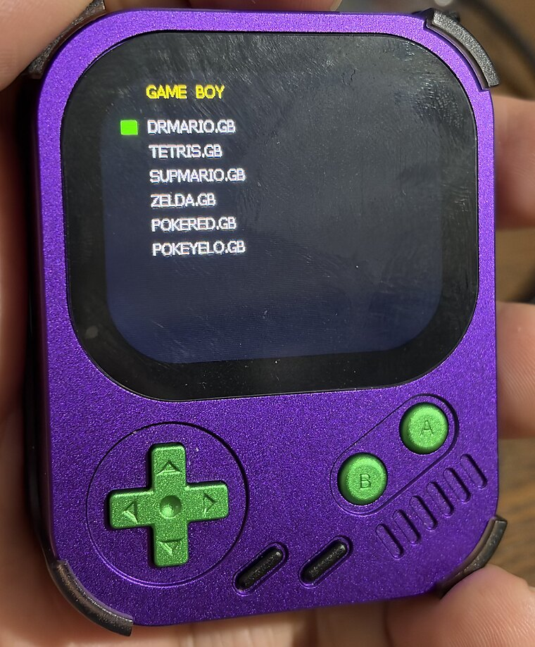
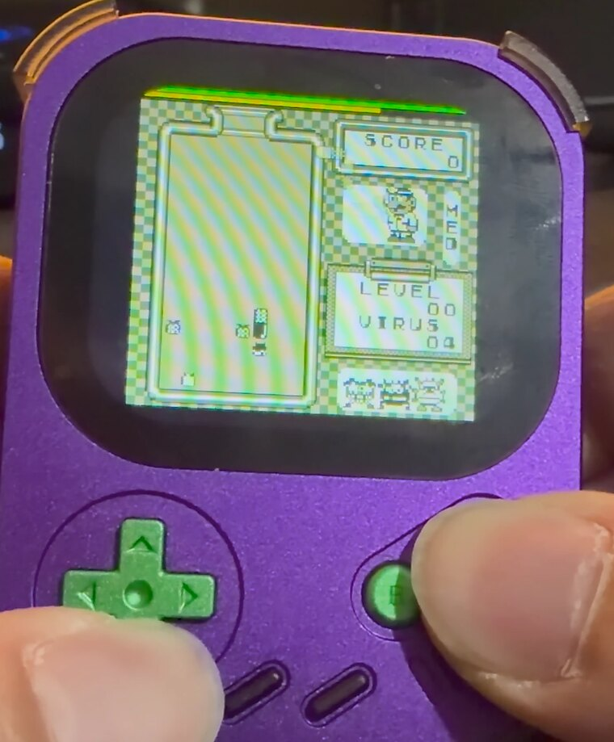
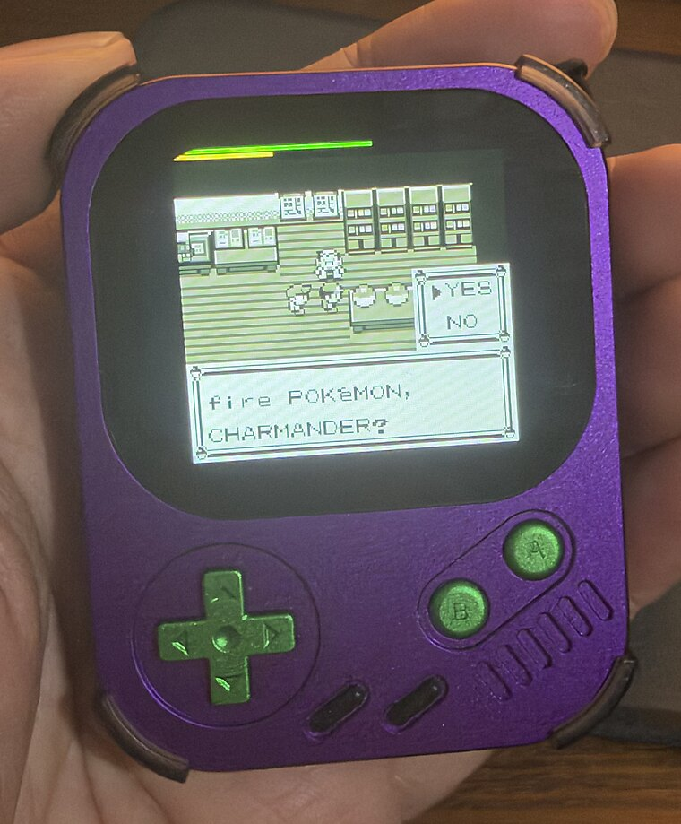

# Game Boy on a Hidizs AP30 Music Boy

The [Hidizs AP30](https://www.hidizs.net/products/hidizs-ap30-music-boy-the-truly-wearable-palm-sized-hi-res-music-player)
is a tiny music player shaped like a Game Boy. 

It has a D-pad, A and B
buttons, select and start button, and a few built-in games (spoiler: they ain't great), but it can't play actual Game Boy games.
This project takes the firmware apart and fixes that, so this little guy can live up to its form factor.


<p align="center">
  
  
  
</p>

## TL;DR

- Custom firmware that puts a Game Boy emulator on the AP30. Pick a ROM from
  a list, play, save.
- Needs stock firmware v1.7.8 (`HIFIYF18.IMG`), Python 3 and LLVM. No
  firmware or games are included.
- Build and flash:

  ```sh
  python ap30.py rollback        # a way back to stock, make it first
  python ap30.py gb              # builds build/gb/HIFIYF18.IMG
  # format the player's internal storage from its menu, connect USB, then:
  python ap30.py flash "/Volumes/NO NAME" --roms roms/gameboy
  # eject, restart the player, open Game > Game Boy
  ```

What's in the repo:

- a tool to unpack and repack the AP30 firmware image
- a Game Boy emulator that replaces one of the stock games, with a ROM picker
  and save files
- a Game & Watch emulator (Sharp SM510), which works but is far less finished
- the reverse-engineering notes, in [`docs/FINDINGS.md`](docs/FINDINGS.md)

No firmware and no games are included. You bring your own.

This is an unofficial hobby project. It is not affiliated with or endorsed by
Hidizs. It was started by an early Kickstarter backer of the AP30 who wanted
more out of the device.

## Read this first

**Flashing can brick the player.** The AP30 has no reset hole, unlike the Echosnow Mini, so an image that doesn't boot may risk bricking it. 
So far everything has been developed and tested on a single
player (My own device got flashed several times and it was fine, but consider yourself warned).

**Only firmware v1.7.8 is tested** (`HIFIYF18.IMG`, header date
2026-10-19, download from https://www.hidizs.net/pages/download-center). The emulators call functions inside the firmware at fixed
addresses, so a build made for the wrong version would crash. The build
looks up the image's hash in `fw/` and stops if it has no address table for
it. See [Other firmware versions](#other-firmware-versions) for how to add
one.

## Setup

You need Python 3.9 or newer and LLVM (clang, lld, llvm-objcopy, llvm-nm).
Nothing else is required to build and flash.

| | |
|---|---|
| macOS | `brew install llvm lld` |
| Linux (Debian/Ubuntu) | `sudo apt install clang lld llvm` |
| Windows | `winget install LLVM.LLVM`, then open a new terminal |

The build looks for the tools in Homebrew's folders, in
`C:\Program Files\LLVM\bin`, and then on `PATH`. To point it somewhere else,
set `LLVM_BIN` to the folder that contains them. Apple's own clang is not
enough because it comes without lld.

Get the stock firmware from the
[Hidizs download center](https://www.hidizs.net/pages/download-center), put
`HIFIYF18.IMG` in the `firmware/` folder, and check everything is in place:

```sh
python ap30.py check
python ap30.py info      # the crc line should say "(ok)"
```

On macOS and Linux the command may be `python3`. There is also a `Makefile`
with the same commands as shortcuts (`make gb`, `make flash-roms`, ...) for
anyone who has make.

Development so far has been on macOS. The scripts avoid anything
platform-specific, but Linux and Windows builds have not been confirmed on
real machines yet. Reports and fixes are welcome.

## Building and flashing the Game Boy

```sh
python ap30.py rollback     # do this first, see below
python ap30.py gb
```

That produces `build/gb/HIFIYF18.IMG`. Put your ROMs in `roms/gameboy/`,
then:

1. On the player, format internal storage from its own settings menu.
2. Take the microSD card out and connect USB.
3. Copy the image and the ROMs. Use the path where the player shows up on
   your system:

   ```sh
   python ap30.py flash "/Volumes/NO NAME" --roms roms/gameboy     # macOS
   python ap30.py flash /media/$USER/XXXX --roms roms/gameboy      # Linux
   python ap30.py flash E:\ --roms roms\gameboy                    # Windows
   ```

4. Eject the drive safely.
5. Restart the player. It should show "Updating..." for a while and reboot.

**Note for ROMS**: if you want to just simply copy over the roms, just copy them into the root of the internal storage. Make sure you rename them to just 8 characters then .GB extension (i.e. DRMARIO.gb, POKEMON.gb) for best chance of compatibility. That way you don't have to worry about reflashing all the time. But if you use the script it renames for you automatically.

Then open Game > Game Boy.

`rollback` builds plain stock firmware with a later date and puts it in
`build/rollback/`. Flash it the same way to go back
(`python ap30.py flash VOLUME --image build/rollback/HIFIYF18.IMG`). Make it
before you need it.

Flashing has a few rules, all found by getting them wrong:

- Format internal storage right before every flash. Without a fresh format
  the player silently deletes the file and does nothing.
- The file on the player must be called `HIFIYF18.IMG`. `flash` takes care of
  that.
- Every image gets a newer header date than the one installed
  (`python ap30.py gb --date 2026-11-01`). Whether the player really needs
  this has never been tested.
- To add or swap games later, connect without formatting and run `flash`
  with `--no-image --roms roms/gameboy`.

## Playing

The picker lists the ROMs on the player. Up and Down move, A or Start starts
a game, and a long press on Select returns to the player's menu.

ROMs and saves are read from the player's internal storage, with or without
a microSD card inserted. Games on the card itself are not listed.

The awkward part of this hardware is the buttons. All of them except power
share one analogue pin, each through a different resistor, so the player can
only see one button at a time. Hold Right and press A, and it sees Right.
Software can't change that.

Tetris and Pokémon don't care. Platformers do, so there is a workaround:
start the game with B instead of A. Left and Right then act as toggles (tap
to start moving, tap again to stop), which leaves a thumb free for jumping.

Saves: for a game with battery memory, the emulator loads `NAME.SAV` from
next to the ROM, writes it back a couple of seconds after the game saves,
and again on exit. If there is no save file yet, it creates an empty one the
first time the game starts, so ROMs copied over by hand save too. An existing
save is never replaced by a new one.

Not working yet:

- sound
- Game Boy Color games
- games with more than 32 KB of save memory
- long file names (ROMs are copied as `POKEMON.GB` and so on)

Speed depends on the game. Dr. Mario and Pokémon run at full speed. Tetris
and Zelda were clearly slow on the last build measured on hardware; later
changes have not been measured yet. The bars at the top of the screen are a
speed meter: green is game speed, yellow is frames actually drawn, full
width is 60 per second. The red bar at the bottom shows reads from storage.

The emulator takes the place of three stock games. It lives where Tank
Battle was and is large enough to spill into the two games stored after it.

## Game & Watch

This was the first experiment and is rougher. It emulates the Sharp SM510
and runs a raw ROM dump that is built into the image. It uses the same slot
as the Game Boy, so it's one or the other.

```sh
python ap30.py gw-demo      # a small original test ROM, to see it working
python ap30.py gw --rom tl-28 --svg gnw_tbridge.svg --keys gamewatch/games/tbridge.json
python ap30.py flash VOLUME --image build/gw/HIFIYF18.IMG
```

The ROM and artwork are the files MAME uses. Artwork needs `rsvg-convert`
(librsvg) and Pillow; without artwork every LCD segment is drawn as a box in
a grid. The key file maps AP30 buttons to the chip's inputs.

On the device it has only run the test ROM, never a real game. The CPU core
passes its tests but should be treated as unproven. No sound, no two-screen
games, and SM510 titles only.

Note that `.mgw` files are not ROM dumps. They are Lua simulations for a
different emulator and contain no chip program to run.

## Just modding the firmware

For a different boot logo or menu graphics:

```sh
python tools/rknanofw.py unpack firmware/HIFIYF18.IMG work
# replace any BMP in work/images/ with one of the same size
python tools/rknanofw.py pack work NEW.IMG
```

The firmware is not signed. Integrity is a magic string, a copy of the
header and a CRC, and `pack` handles all three.

## Other firmware versions

Every firmware address the Game Boy module uses lives in a table,
[`fw/1.7.8.json`](fw/1.7.8.json): 25 functions, 9 variables and where games
are loaded. That one was worked out by hand and has run on a real player.

For a different version, `findaddrs` writes a first draft:

```sh
python ap30.py findaddrs firmware/NEW.IMG -o fw/new.json
```

It searches the new image for the opening bytes of each function as they
appear in v1.7.8, ignoring the parts that move between builds (branch targets
and pc-relative offsets), and reads the variable addresses out of the
functions it matched. Run on v1.7.8 itself it reproduces the hand-made table
exactly. Run on an older image from 2026-08 it finds 24 of the 25 functions
and all 9 variables, at different addresses.

A draft is not a port. It is marked `"verified": false`, lists what it could
not find under `"missing"`, and the build refuses it until someone has:

1. found the missing entries by hand (the notes describe what each function
   does),
2. filled in `game.menu_name` and checked `game.slot`, the stock game to
   replace,
3. run the module in the PC harness against that firmware,
4. and only then flashed it, on a player they are prepared to lose.

A match only means a function starts the same way. If Hidizs changes what a
function does but not how it begins, the finder will not notice. The Game &
Watch module and the test harness still have their v1.7.8 addresses written
into the source.

## Tests

```sh
pip install unicorn pillow
python ap30.py test                              # only needs the stock firmware
python ap30.py test-gb roms/gameboy/GAME.gb      # needs a ROM of yours
```

The tests also need a C compiler for your own machine (`cc`, `gcc` or
`clang`).

The harness in `common/harness.py` loads the real firmware code into an ARM
emulator (Unicorn), loads a game module the way the player would, and calls
it the way the player's window manager does. Drawing, messages and the FAT
filesystem are the vendor's own code running against emulated RAM and a disk
image. The screen is then compared pixel for pixel with a desktop build of
the same emulator core.

It catches most mistakes before they reach a device. It can't check what
needs real hardware: timing, the buttons, and text (the font is read from
flash).

## Contributing

Issues and pull requests are welcome. Some things that would help most:

- **A recovery path.** Finding a way into the SoC's USB boot mode on the AP30
  would make all of this much less risky.
- **Sound.** The notes describe the audio path (I2S, DMA, the DAC) from
  static analysis; nothing has been tried.
- **CPU speed.** It is not known whether the firmware runs games at a
  reduced clock. The picker's bottom line prints the firmware's clock
  bookkeeping for anyone who wants to dig.
- **Other firmware versions.** Verified tables for `fw/`, and making the
  harness and the Game & Watch module read them too. Both still assume
  v1.7.8.
- **Linux and Windows.** Build reports, and fixes where it breaks.
- **Game compatibility.** Which games work, which don't, and how fast.
- **The Snowsky Echo Mini.** It uses the same SoC and a closely related
  firmware; much of this probably carries over.

A few ground rules:

- Never commit firmware, ROMs or anything built from them. `.gitignore`
  covers the usual cases; check `git status` before pushing.
- Run `python ap30.py test` before sending a change, and `test-gb` with a
  ROM if you touched the Game Boy module.
- If you tried something on a real device, say so, and say which build. A
  lot of what's in the notes is static analysis, and the difference matters.
- New findings about the firmware go in `docs/FINDINGS.md`.

## The notes

[`docs/FINDINGS.md`](docs/FINDINGS.md) holds everything worked out so far:
the image format, the module table, the memory map, the firmware functions a
game can call and what they do, how the buttons are wired, and a log of
every flash attempt. It is a lab notebook, not documentation: long,
chronological, and with some older paths that predate this repo layout.
Anyone writing their own module should start there.

## Layout

```
ap30.py        the entry point for everything
firmware/      your stock image (not in git)
roms/          your ROMs (not in git)
fw/            firmware address tables, one per supported version
tools/         unpack/pack, flash helper, address finder, test disk maker
gameboy/       the Game Boy front-end and its build script
gamewatch/     the SM510 core, front-end and artwork converter
common/        linker script and the PC harness
third_party/   Peanut-GB
docs/          notes and photos
build/         everything generated (not in git)
```

## Credits

- The Game Boy core is [Peanut-GB](https://github.com/deltabeard/Peanut-GB)
  by Mahyar Koshkouei: a single MIT-licensed header, included unmodified in
  `third_party/`. This project only adds the part that talks to the player.
- The SM510 core was written for this project, with MAME's `sm510` source
  (by hap) as the reference for what each opcode does.
- The Snowsky Echo Mini community had already worked out a lot about this
  platform: [ReChord](https://github.com/brnomt/ReChord),
  [Flame Ocean](https://github.com/losses/flame-ocean-website) and
  [Echo-Mini-Customizer](https://github.com/BlackVllad/Echo-Mini-Customizer).
- Blargg's test ROMs confirmed the CPU core before anything was flashed.

## License

MIT, see [`LICENSE`](LICENSE).

The firmware belongs to Hidizs. Game
Boy and Game & Watch are trademarks of Nintendo. This project has no
connection to either company.
